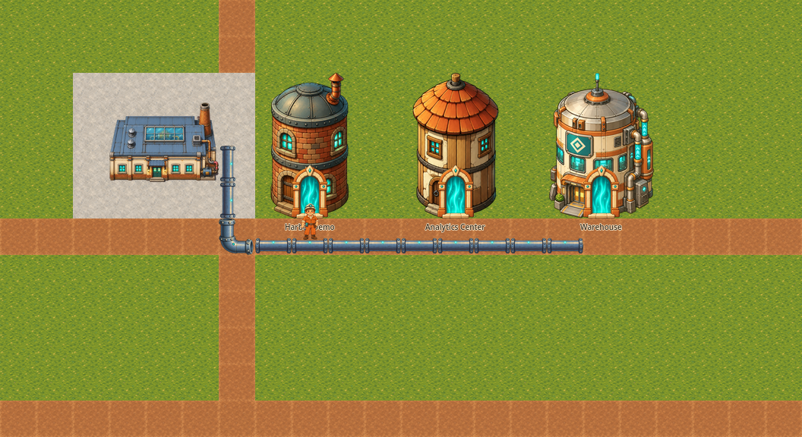
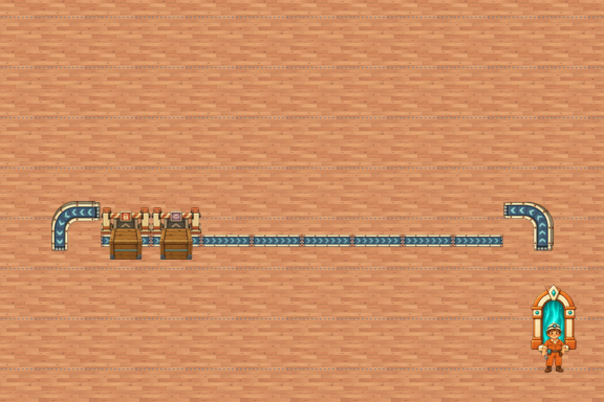

설계한 구조를 실제로 만들었다. 캐릭터와 건물과 맵 에셋은 agent-sprite-forge로 만들었다. 에셋을 전부 AI에게 맡기기로 한 계획의 첫 실행이었다.

Godot으로는 캐릭터 이동, 건물 생성, 포탈 전환, 정책 설정까지 만들었다. 설계에서 정한 동작이 하나의 필드 위에서 실제로 돌아갔다. 이 아이디어가 구현 가능하다는 것을 확인했다.

동작은 문제가 없었지만 화면은 기대에 못 미쳤다. 공간감이 느껴지고 캐릭터 애니메이션이 자연스럽게 이어지는 화면을 기대했다. 결과는 2D라는 평면의 느낌만 남았다. 재미를 느끼기보다 어린아이 작품 같은 결과에 한숨이 나왔다. 첫 시도이므로 이 부분은 공부할 대상으로 남긴다.

에셋보다 더 어려운 문제가 필드에 있었다. 실제 서버에는 100개가 넘는 db 커넥션이 있다. 이 커넥션을 모두 건물로 필드에 세우면, 원하는 커넥션을 찾아가려면 키보드로 아주 많이 움직여야 한다. 재미삼아 하는 프로젝트라도 결국 관리 도구이므로 관리는 용이해야 한다고 판단했다. 필드 위를 걸어 다니는 구조만으로는 이 조건을 만족하기 어렵다. UI와 UX를 다시 고민하게 된 지점이다.

이번 시도로 두 가지가 남았다. 아이디어를 실제로 구현할 수 있다는 가능성과, 에셋과 UI와 UX라는 부족한 부분이다. 앞으로는 게임 개발의 일반적인 방법을 익히는 것과 이 게임의 UI와 UX를 고민하는 일을 병행하려고 한다.
