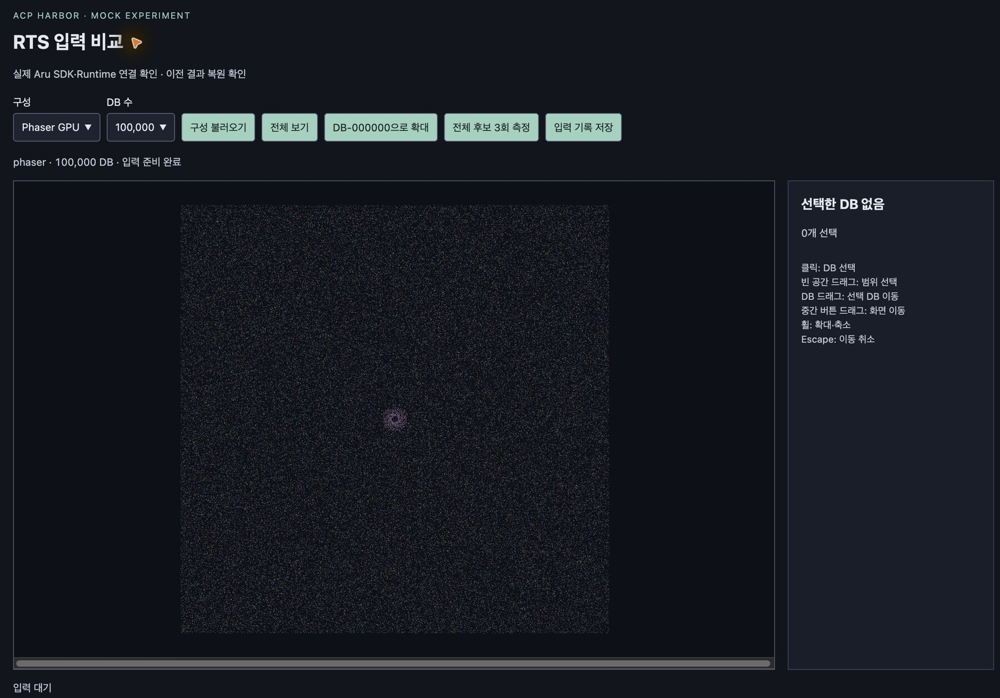
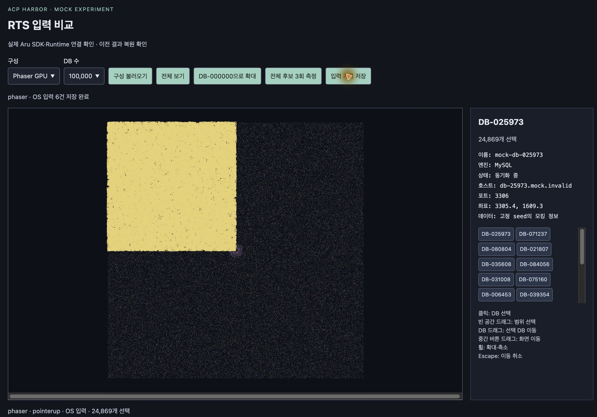

개념과 작업 방식이 정해졌으니 이제 만드는 일만 남았다. 그런데 만들어야 할 것 중에 게임 엔진 밖의 문제가 하나 있었다. 작업자인 AI 에이전트를 무엇으로 구동할 것인가다. 별도의 LLM 클라이언트가 필요했다.

먼저 떠올린 방법은 CLI 기반 LLM 클라이언트의 헤드리스 채팅을 이용하는 것이었다. Pi 같은 도구고, 이전 프로젝트에서 써 본 적이 있어서 해볼 만했다. 다만 게임과 별개로 클라이언트를 직접 관리하는 비용이 따라붙는다. 재미삼아 하는 프로젝트에 관리 대상을 하나 더 얹고 싶지는 않았다.

고민하다가 적절한 답이 가까이 있었다. 회사의 또 다른 제품 Aru다. Aru는 Codex Desktop 같은 도구로, 채팅으로 LLM과 그 생태계를 쓰는 데스크탑 프로그램이다. 사용자가 플러그인을 추가할 수 있고, 채팅 관련 시스템은 이미 다 갖춰져 있다. 나는 플러그인 안에서 채팅을 빌려 쓰기만 하면 된다.

이 선택의 대가도 분명했다. Aru 플러그인은 웹 기술로 만든다. 웹뷰 안에서 HTML과 CSS와 JavaScript가 동작하고, Aru의 기능은 SDK를 통해 쓴다. Godot을 유지하면서 플러그인이 되는 길은 없었다. 그래서 물어야 할 질문은 어떤 엔진이 나은지가 아니라, 브라우저에서 이 게임이 실제로 될 수 있는지였다.

검증의 초점은 규모였다. RTS 인터페이스는 맵 위에서 많은 대상을 그리고, 확대와 축소와 드래그와 선택을 부드럽게 해야 한다. db 커넥션은 10만개까지 늘어날 수 있으므로, 웹에서 이 규모가 되는지를 먼저 확인하기로 했다. 웹 렌더링의 대표 라이브러리 다섯 가지를 후보로 삼았다. PixiJS, Phaser, deck.gl, 그리고 둘을 섞은 조합 두 가지다.

*실험용 플러그인 화면. 후보와 DB 수를 바꾸고 확대, 입력, 반복 측정을 같은 화면에서 실행했다.*

공정한 비교를 위해 조건을 고정했다. 같은 시드로 만든 모의 db 위치와 상태를 후보마다 똑같이 넣었고, 범위 검색은 모두 같은 공간 인덱스를 썼다. 일반 브라우저에서 확인한 뒤, 같은 화면을 Aru 플러그인으로 패키징해 실제 탭에서 다시 측정했다. 후보마다 세 번씩, 총 15회 실행에서 9,024개의 프레임 간격을 수집했다. 실제 Aru 안에서는 일부 라이브러리 초기화가 CSP에 막히는 문제도 있었지만, 보안 설정을 느슨하게 하지 않는 선에서 해결했다.

결과는 충분했다. 프레임 p95는 후보 전체가 16.7에서 16.8ms로 약 60fps를 유지했다. 1,000개를 한 번에 이동하는 비용은 Phaser가 2.7ms였다. 범위 선택에서는 한 번에 49,151개를 선택하고 모두 테두리로 표시해도 약 60fps였다. 물론 모든 순간이 일정하지는 않았다. 25ms를 넘는 프레임이 16개 있었고 최대는 33.5ms였다.

합성 입력만으로는 부족하니 OS 마우스로 클릭, 드래그, 범위 선택을 직접 수행하는 검증도 따로 했다. 클릭과 드래그와 선택이 화면과 상태에 정확히 연결됐고, 탭을 다시 열어도 실험 기록이 보존됐다.

*실제 입력 검증 화면. 선택된 모든 db에 테두리를 그렸고, 개수 표시로 비용을 줄이지 않았다.*

따라서 렌더러는 Phaser 단독으로 정했다. 혼합 구성을 먼저 도입할 성능 근거는 없었고, WebGL 캔버스 두 개의 좌표와 수명을 함께 관리할 이유도 없었다. 다만 10만개를 GPU에 묶어 그리는 경로를 검증한 것이지, 모든 객체를 무겁게 만들어도 같다는 뜻은 아니다. 실제 데이터 갱신, 저사양 장비, 장시간 실행은 아직 확인하지 못했다.

Godot 없이 Aru 플러그인으로 게임을 만들기로 확정했다. 게임도 Aru 안에서 동작하고, AI 에이전트 작업자도 별도 클라이언트 없이 Aru의 채팅으로 동작한다. 관리 도구와 게임과 에이전트가 한 프로그램 안에 들어가는 구조로 방향이 모였다.
