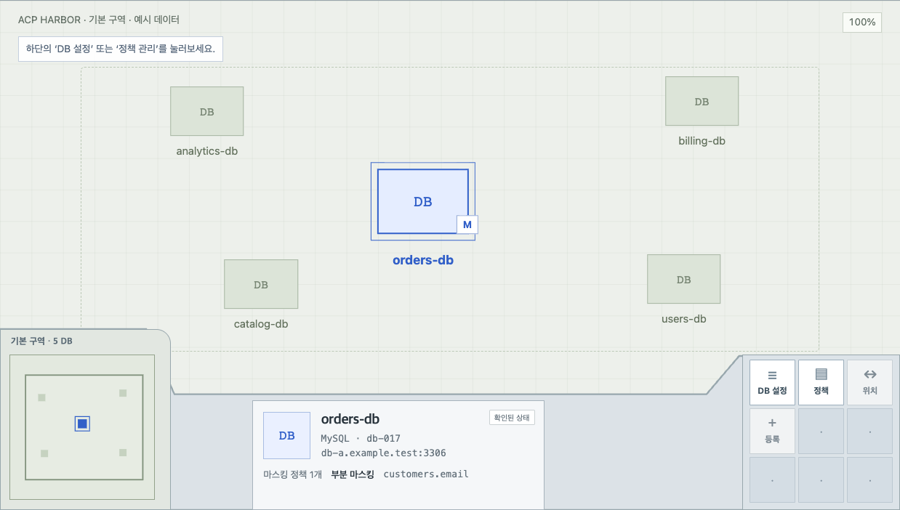
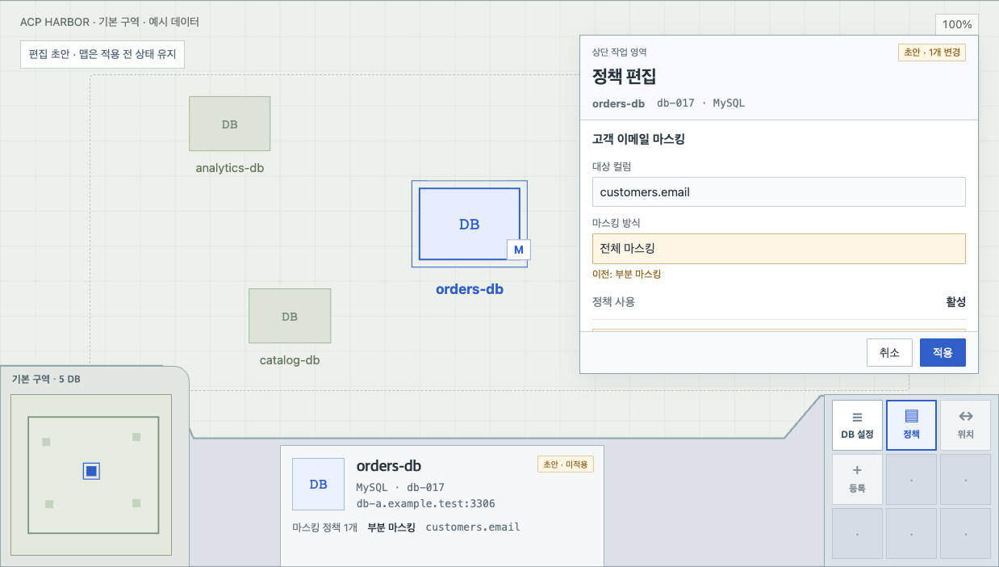
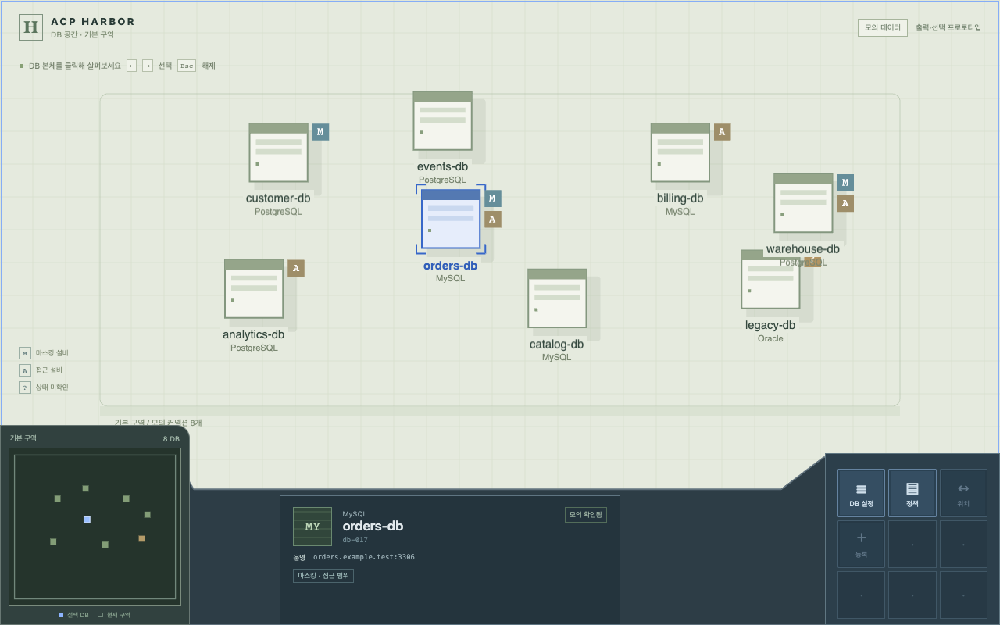

방향이 정해졌으니 이제 화면의 모양을 정할 차례였다. Phaser로 웹에서 맵을 그릴 수 있다는 건 확인했으니, 남은 질문은 그 맵을 어떻게 배치할지였다. 처음 제안에는 오른쪽에 작업 패널이 있었고, 편집창을 하단에 넣는 방법도 생각했다. 하지만 내가 자주 하고 싶은 일은 목록을 한 줄씩 열어 보는 게 아니라, 넓은 맵에서 대상을 고르고 바로 손을 대는 일이었다.

[스타크래프트 인터페이스를 따오기로 한 결정](/blog/projects/acp-harbor/logs/05-rts-interface/)에서 가져온 건 순서였다. 위에는 큰 맵을 놓고, 아래에는 왼쪽 미니맵, 가운데 선택한 대상의 설명, 오른쪽 3×3 명령판을 뒀다. 정책 버튼을 누르면 편집창이 상단 맵 일부에 겹친다. 명령판 자체를 폼으로 바꾸지 않았다. 그래서 화면을 보면서 내가 고른 DB가 무엇인지 놓치지 않았다.

*당시 검토한 와이어프레임을 원본 HTML에서 다시 캡처한 화면. 맵에서 DB를 고르면 하단 설명과 상단 상세가 같은 대상을 가리킨다.*

*와이어프레임의 정책 편집 화면. 편집창이 상단 맵 위에 겹치고, 적힌 마스킹과 폼 값은 실제 동작이 아니라 예시다.*

그다음에는 입력창부터 만들려다 순서를 바꿨다. DB 여덟 개를 박스로 놓고, 클릭하면 맵의 선택 표시와 하단의 설명, 상단의 읽기 전용 상세가 같은 대상을 가리키게 만들었다. 첫 버전에는 우측 상단에 DB 목록도 뒀는데, 직접 열어 보니 이 단계에서 확인할 조작은 맵 위 클릭이었다. 다음 버전에서 목록을 빼고 맵과 방향키로 고르는 길을 남겼다.

*0.1.1 배포 번들의 당시 브라우저 검사 화면. DB 여덟 개를 박스와 설비로 표현하고 클릭 선택을 하단 설명과 연결했다.*

이 단계에서 중요한 건 건물을 그럴듯하게 만드는 일이 아니었다. 박스만으로도 어느 DB에 손을 대고 있는지 알 수 있는지였다. 그게 보이니 이제 위치와 설정을 실제로 바꿔 볼 수 있었다.
