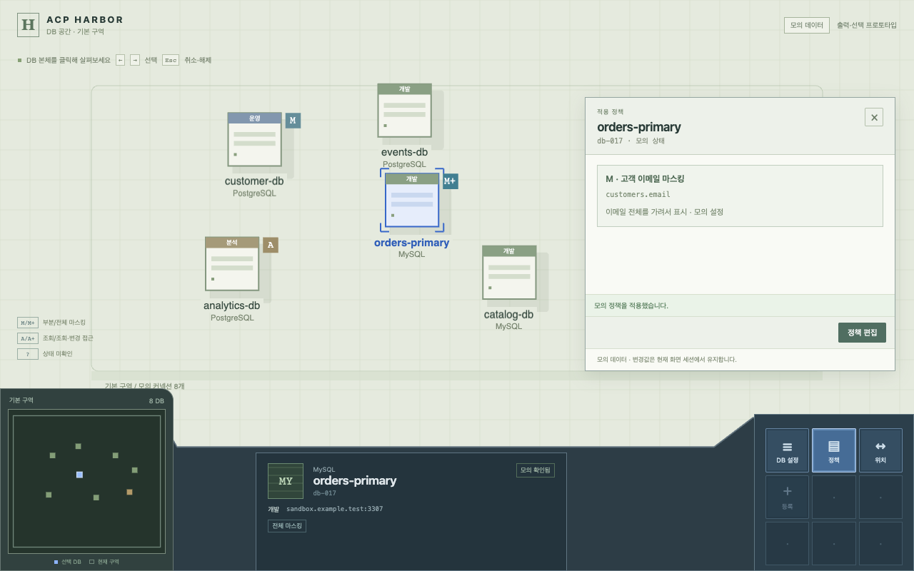
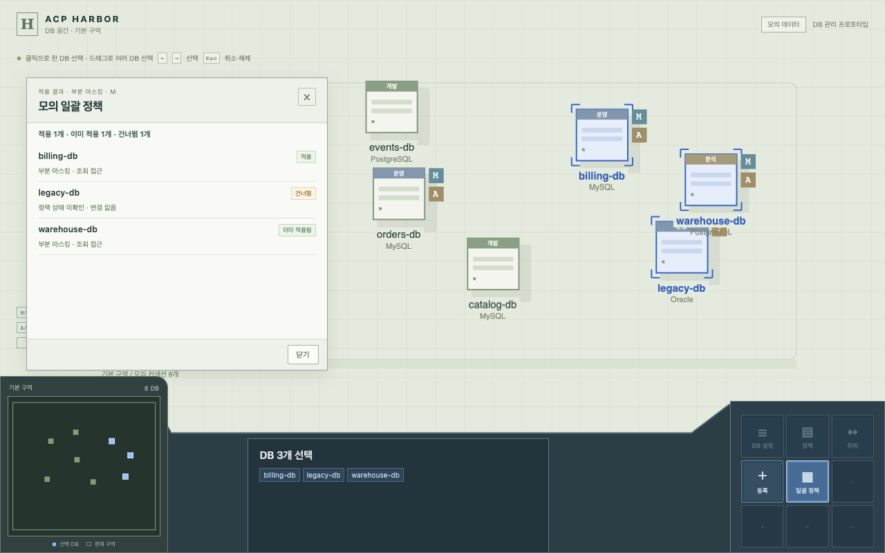
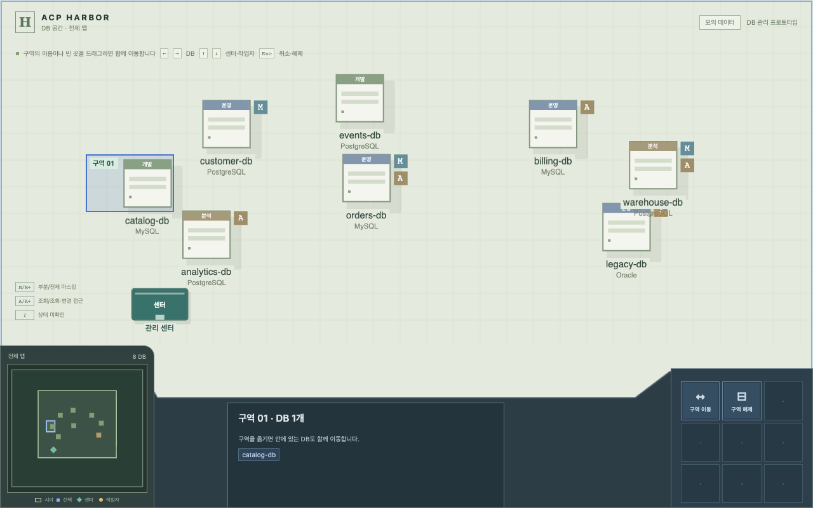

선택이 되니 이제 고른 DB에 손을 댈 차례였다. 먼저 위치였다. `위치`를 누르고 목적지에 마우스를 올리면 옮겨질 자리가 먼저 보인다. 다른 시설과 겹치는 곳에는 놓을 수 없고, 취소하면 본체와 미니맵 모두 제자리에 남는다. 미리보기와 확정의 경계를 여기서 처음 정했다.

같은 원칙을 설정과 정책에도 썼다. 마스킹이나 접근 정책을 편집하는 동안에는 맵을 그대로 둔다. 모의 적용을 확정하면 건물 옆에 붙는 `M/M+`, `A/A+`가 바뀐다. 정책이 없는 DB와 아직 정책 상태를 모르는 DB를 구분한 것도 중요했다. 표시가 같으면 관리자는 모르는 것을 없는 것으로 읽기 쉽다.

*0.1.3 배포 번들의 당시 브라우저 검사 화면. 마스킹 정책을 확정한 뒤 건물 옆 표시가 `M+`로 바뀌고 상세 패널에 적용 내용이 남는다.*

새 DB도 정보와 위치를 확정한 뒤에만 맵과 미니맵에 올라왔다. 등록 순서 자체는 나중에 다시 바꾸게 된다.

그다음은 여러 개였다. 맵을 드래그해 여러 DB를 골라 같은 정책을 적용했다. 적용 전에는 대상 목록을 보고, 끝나면 새로 적용된 DB와 이미 같은 정책이 있던 DB, 상태가 미확인이라 건너뛴 DB를 따로 볼 수 있게 했다.

*0.1.5 배포 번들의 당시 브라우저 검사 화면. 드래그로 고른 DB 세 개의 결과를 적용됨, 이미 적용됨, 건너뜀으로 구분해 보여준다.*

대상이 많아지자 구역의 경계도 필요했다. DB 한 개는 들어갈 수 있어 보이는데 배치가 거부되는 경우가 있었다. 실제 박스와 설비의 크기에 맞춰 기준을 고쳤다. 여러 DB나 구역을 옮길 때는 한 개라도 경계를 걸치면 전체가 움직이지 않는다.

*0.1.12 배포 번들의 당시 브라우저 검사 화면. 작게 그린 구역에 DB가 들어가지 않던 배치 기준을 설비 크기에 맞춰 고친 뒤의 화면이다.*

이 단계의 성과는 건물 여러 개를 고르는 재미가 아니라, 내가 고른 대상과 변경된 대상을 같은 화면에서 설명한 것이다. 이제 이 맵 위에서 일을 대신해 줄 작업자가 필요했다.
