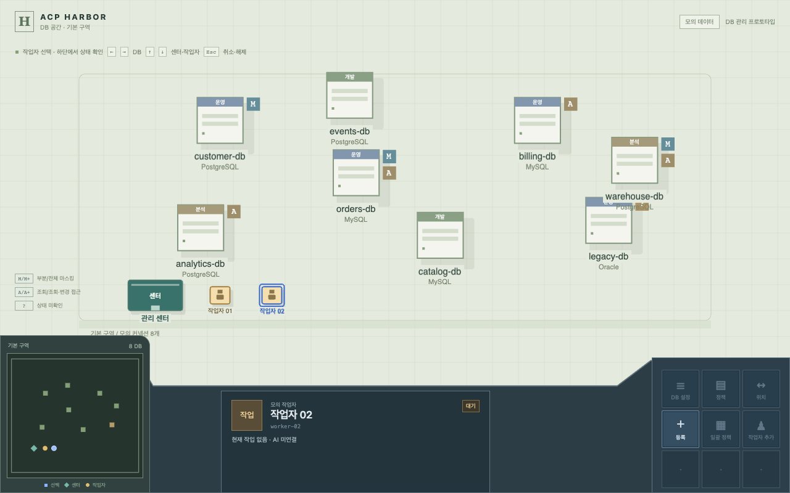
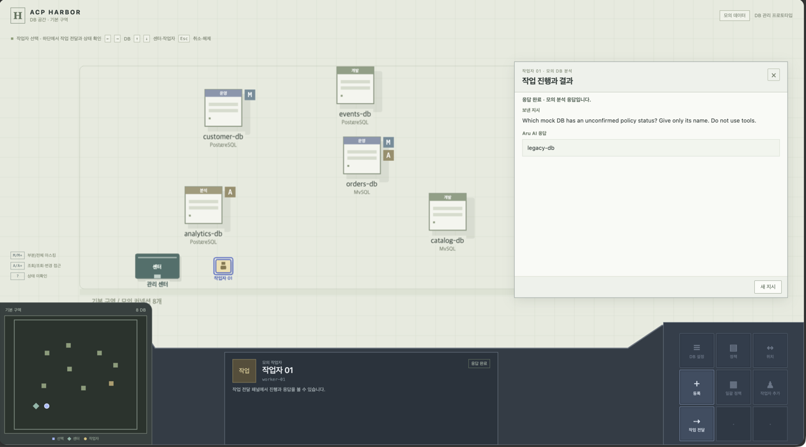

관리 센터를 처음 넣었을 때 AI와는 아무 관계가 없었다. 센터에서 작업자를 추가하면 맵에 나타나고, 작업자를 누르면 하단에서 누구인지와 상태를 볼 수 있었다. 이후에는 센터도 처음부터 깔려 있는 건물이 아니라, 내가 필요할 때 자리를 정해 놓는 건물로 바꿨다.

*0.1.6 배포 번들의 당시 브라우저 검사 화면. 작업자 둘을 추가하고 한 명을 선택하니 하단 패널에 상태가 표시된다.*

여기에 붙인 첫 AI 조작은 작았다. 작업자를 고르고 `작업 전달`을 눌러 자연어로 지시한다. 뒤에서는 Aru 채팅이 실행된다. 사용자가 별도 채팅 탭으로 이동할 이유는 없었다. 요청이 진행 중인지와 응답 내용은 작업자 패널에서 읽도록 했다.

전송은 됐는데 첫 시도에서 응답을 읽지 못했다. 응답을 읽는 경로를 수정한 뒤, 실제 Aru 탭에서 모의 DB를 분석한 응답이 패널로 돌아오는 것까지 확인했다.

*실제 Aru 탭에서 실행한 화면. 모의 DB의 정책 상태를 묻는 지시에 Aru AI가 답한 결과가 작업자 패널에 표시됐다. 창 가장자리는 잘라내고 플러그인 화면만 남겼다.*

이 작업자가 맵을 움직이거나 정책을 바꾼 것은 아니다. 이 PoC에서 확인한 것은 지시를 주고 답을 받는 동선이다. 이 구분을 남겨둔다. 화면에 작업자가 보이는 것과, 실제 관리 작업을 수행할 권한과 도구가 마련된 것은 다른 문제다.

작업자에게 일을 맡기는 동선은 생겼다. 이제 맵 쪽이 남았다. DB가 늘어나면 맵도 커지고, 닫았다 다시 열 때 배치도 그대로 있어야 한다.
