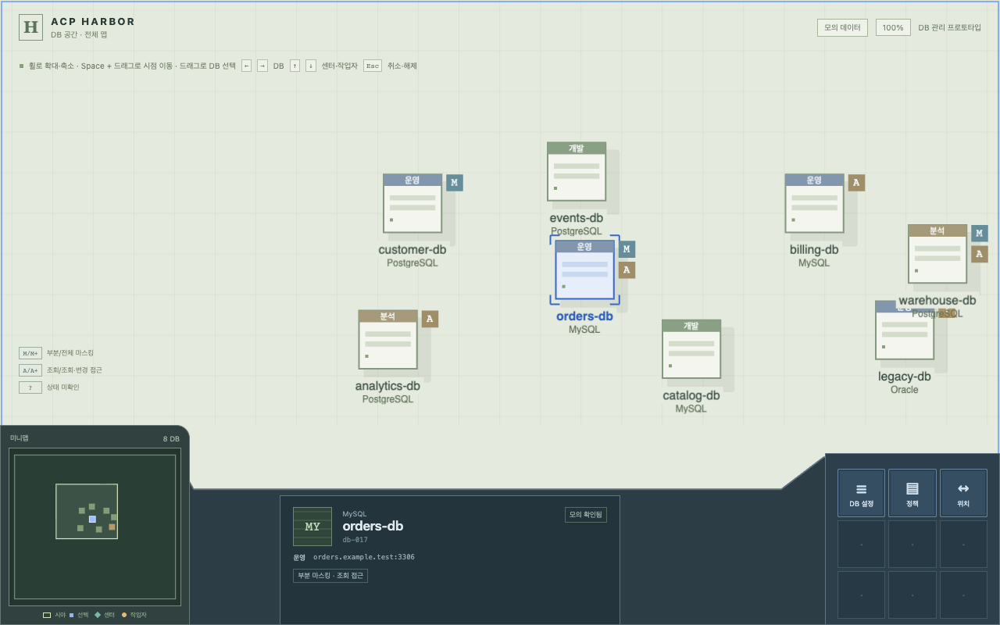
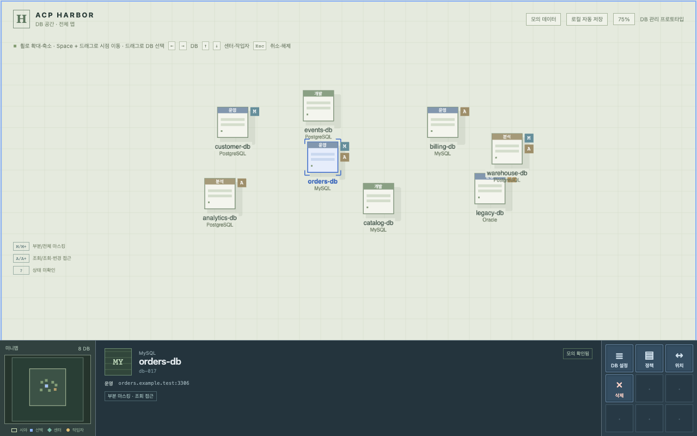
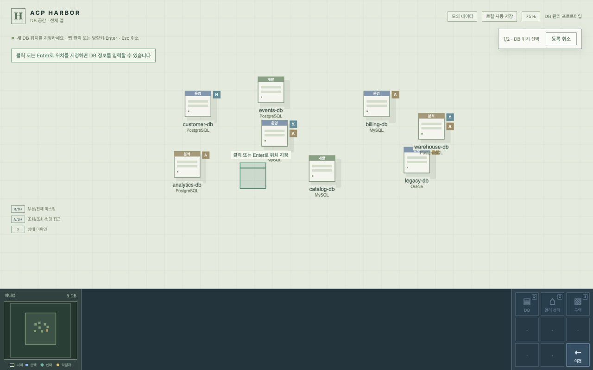

DB가 여덟 개일 때는 맵의 끝이 어디인지 크게 신경 쓰지 않았다. 구역을 나누고 여러 DB를 옮기기 시작하니 고정된 맵보다 draw.io 같은 작업면이 더 어울렸다. 기본 시야를 넓히고, 휠로 확대해도 마우스 아래의 지점은 움직이지 않게 했다. 미니맵의 시야 표시도 줌과 함께 바뀐다. Space를 누른 채 끌면 카메라가 움직이고, 평소처럼 끌면 DB를 선택하거나 옮긴다.

*0.1.16 배포 번들의 당시 브라우저 검사 화면. Space 드래그로 시점을 옮겨도 선택한 DB와 하단 설명은 그대로다.*

배치에 시간을 들일수록 탭을 다시 열었을 때 처음부터 배치하는 일이 더 어색했다. 확정한 배치와 설정은 로컬에 저장했다. 한 개 또는 여러 개를 삭제할 때는 확인한 대상만 제거했다. 한 번 삭제한 모의 DB가 탭을 열었다고 다시 나타나면 안 되니, 그 결과도 복원 검사에 넣었다.

하단 패널은 다각형에서 직사각형으로 바꿨다. 가운데 설명 칸을 숨겨 맵을 넓혀 보기도 했지만, 나중에는 다시 고정했다. 양쪽의 미니맵과 명령판은 정사각형으로 두고, 가운데 설명은 남는 폭을 쓰게 했다.

*0.1.23 배포 번들의 당시 브라우저 검사 화면. 하단 패널을 직사각형으로 낮추고, 정사각형 미니맵과 명령판 사이에 설명 영역을 고정했다.*

등록은 선택 대상에 따라 달라지는 명령판 아래로 옮겼다. `B`로 등록 메뉴를 열고 `D`로 DB를 고른다. 등록에서 눈에 띄게 달라진 건 순서였다. 처음에는 DB 정보를 쓰고 위치를 골랐다. 바꾼 뒤에는 맵의 자리를 먼저 찍고 이름과 호스트를 적는다. 위치를 다시 골라도 쓴 값은 남고, 확정하기 전에는 그 자리에 파란 예정 박스만 보인다.

*0.1.26 배포 번들의 당시 브라우저 검사 화면. 자리를 먼저 찍으면 파란 예정 박스가 표시되고, 확정하기 전까지는 맵에 반영되지 않는다.*

이제 이 조작들이 DB가 많아져도 버티는지 볼 차례였다.
