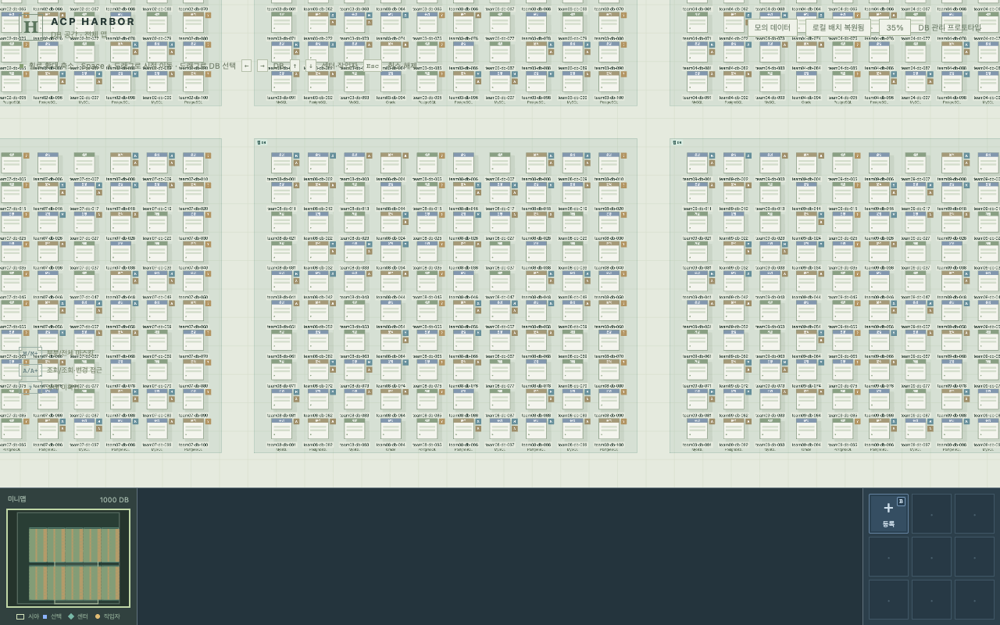
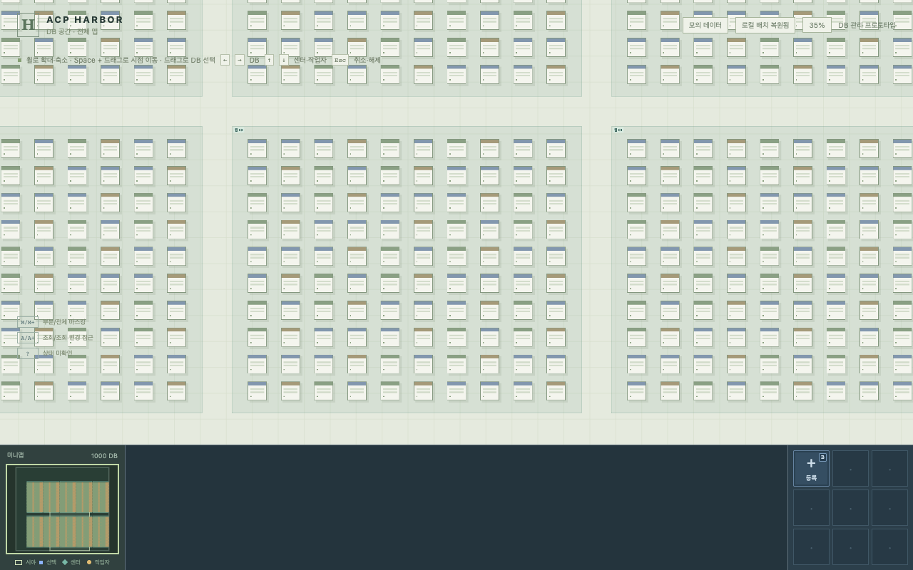
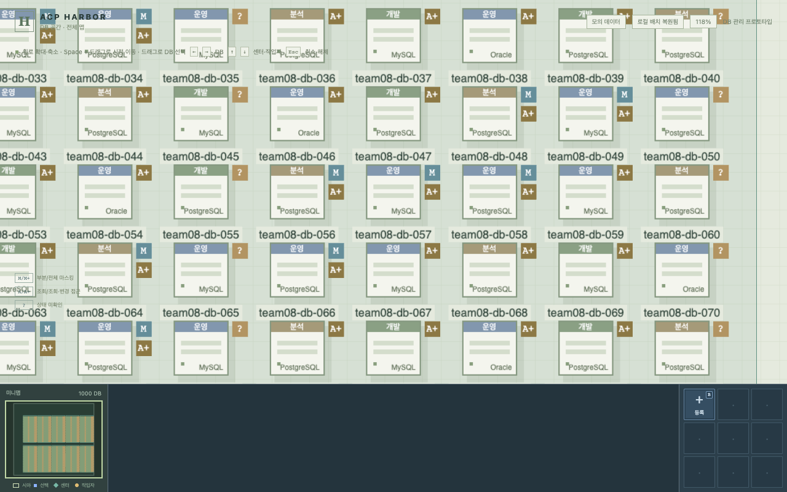

DB를 같은 형태로 1,000개 놓고 실행했더니 한 개를 클릭하는 데 거의 2초가 걸렸다. [앞선 Phaser 실험](/blog/projects/acp-harbor/logs/06-aru-plugin-over-godot/)에서는 10만 개를 띄우고도 맵이 움직였다. 라이브러리는 같았지만 각 DB를 그리는 일이 달랐다. 실험은 단순한 박스를 GPU에 묶어 보냈다. 제품 화면은 DB마다 본체와 이름, 엔진, 설비 텍스트를 따로 만들었고, 선택만 바꿔도 장면의 표시를 다시 만드는 구조였다.

*0.1.26의 모의 DB 1,000개 맵을 Chrome에서 캡처한 전체 화면. 이 상태에서 DB 한 개를 고르는 데 거의 2초가 걸렸다.*

실험에서 썼던 `SpriteGPULayer`로 본체를 묶고, 100% 이상 확대에서 화면에 들어온 DB에만 이름과 설비를 붙였다. 선택 테두리는 이전 대상과 새 대상만 갱신했다.

*0.1.27의 같은 1,000개 맵을 Chrome에서 캡처한 전체 화면. 배치와 배율은 이전 화면과 같다.*

*0.1.27에서 118%로 확대한 화면. 화면에 들어온 DB에만 이름과 엔진, 설비 표시가 붙는다.*

같은 Mac의 Chrome에서 같은 배치를 세 번씩 실행했다. DB 하나를 고르는 응답은 1.96초에서 18ms로 줄었다. 카메라 드래그 중 프레임 간격 P95는 417ms에서 17ms가 됐다. 같은 데이터와 조작 흐름으로 버전만 바꿔가며 본 결과다.

같은 1,000개를 별도 Aru 탭에도 놓았다. 실제 탭에서 한 차례 조작을 재생했을 때 드래그 중 프레임 간격 P95는 16.7ms였고, 한 구역의 DB 100개에 일괄 정책을 적용하는 응답은 61ms였다. 저장까지 대조하니 80개가 바뀌고 미확인 20개는 그대로였다. 실제 마우스 클릭 다섯 건은 별도로 확인했고, 일괄 적용까지 실제 마우스로 검증한 것은 아니다.

여기까지가 모의 PoC였다. 맵에 DB를 놓고 고르고, 변경 결과를 보는 흐름을 확인했다. 10만 개 실험과 이 화면의 1,000개 검증을 합쳤다고 해서, 제품이 10만 개의 실제 DB를 관리할 수 있다고 말할 수는 없다. 이제 남은 질문은 어떤 실제 ACP 데이터를 처음에 받고, 어떤 정보는 DB를 고른 뒤에 읽을지다.
