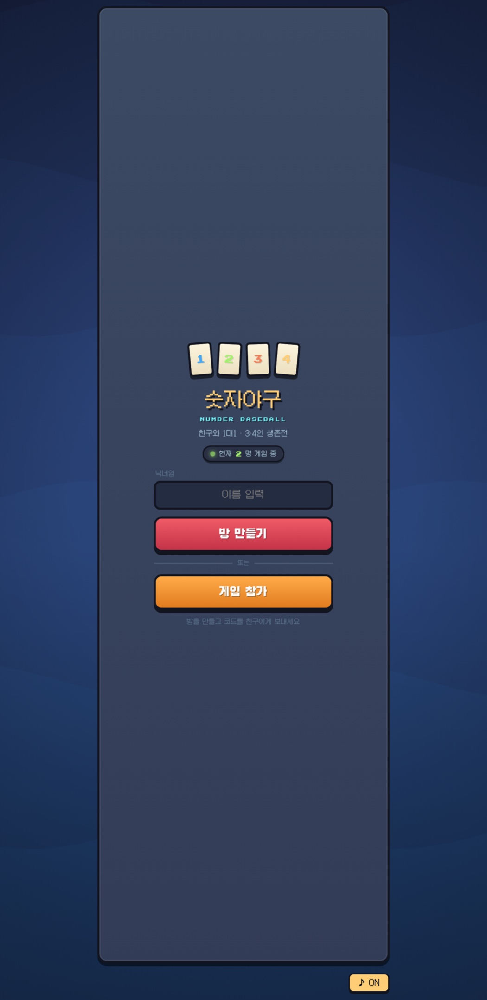
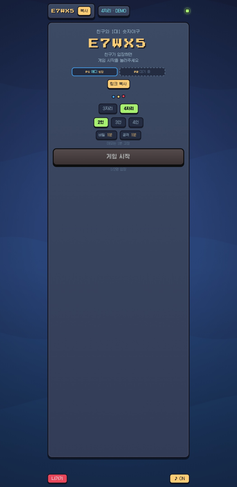
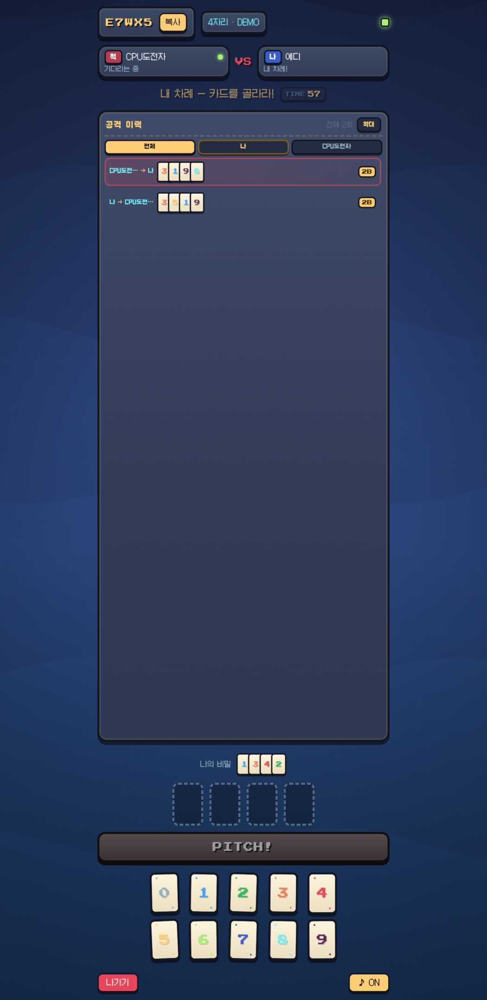

데블스 플랜 3 마지막화에서 수식 신호등이라는 게임이 나왔다. 아내는 처음 들어보는 규칙이라고 했다. 알려주면서 같이 다섯 판 정도를 했고, 이긴 기억은 없다.

다음 날 아내가 또 하고 싶다고 했다. 이 규칙은 숫자를 정하고 판정하는 일만 남는다. 매번 두 사람이 판정을 맡는 대신 게임으로 만들어 두면, 규칙을 기억하고 기록을 관리하는 일이 사라진다.

마침 그 주말에 다른 친구와 만나기로 되어 있었다. 그렇다면 두 명만을 위한 게임이 아니라 네 명이서 할 수 있는 게임으로 만들어야 했다. 게임 규칙 자체가 단순해서, 하루 안에 만들어 배포하는 것을 목표로 삼았다.

구현은 Aru 세션에서 진행했다. 규칙과 구조를 마크다운으로 정해 넘기고, 화면은 완성본을 보면서 같이 다듬었다. 판정은 반드시 서버가 하도록 정했다. 화면이 상대의 비밀 숫자를 받지 않으면 치트를 걸 방법이 없다. 11월 27일 점심에 시작해 같은 날 저녁에 배포를 마쳤다.

화면 연출은 Balatro라는 게임에서 영감을 받았다. 직접 해본 적은 없지만 UI와 이펙트가 인상에 남아 있었다. 턴마다 지루할 틈을 연출이 메워 주면, 추리 게임의 기다림이 덜 지루할 것이라고 판단했다.

지금 만든 것은 1대1 대전과 2~4인 생존전, 방 코드 입장, 제한 시간과 자동 투구, 로비와 실시간 접속자 수 표시다. 배포한 뒤로도 밤까지 이어서 손을 봤다. 4인 생존전은 아직 실제로 해 본 적이 없다. 이번 주말에 친구들과 처음 해본다. 어디가 불편한지는 그때 처음 보일 것이다. 체계를 더 잡는 일은 배포해 보고 사용해 본 뒤에 하기로 했다.

