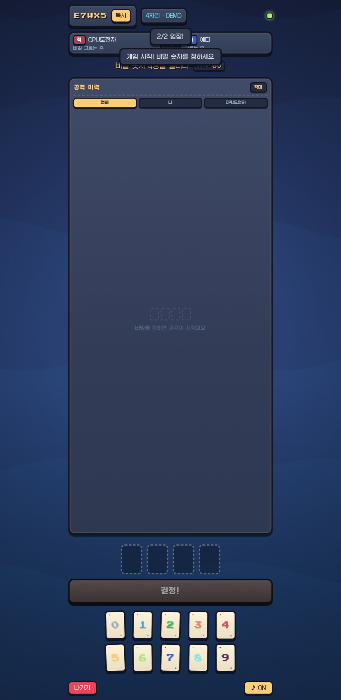

숫자야구는 규칙 설명이 몇 문장이면 끝난다. 나머지 시간은 숫자를 고르고 판정을 기다리는 것이다. 상대의 투구를 기다리는 동안 화면에 아무 일도 없으면, 추리 게임이 아니라 대기 화면이 된다.

착수 전에 Balatro라는 카드 게임이 눈에 들어왔다. 직접 해본 적은 없다. 그런데 UI와 이펙트가 인상에 남아 있었다. 이런 연출을 따라가면 추리 게임의 지루할 부분이 많이 해소되겠다고 판단했다.

그래서 카드 조작감을 먼저 정했다. 카드를 고르면 색 파티클이 터지고 "쾅!"이라는 글자가 뜨면서 화면 전체가 흔들린다. 투구한 카드는 결과 화면 위에 하나씩 내려앉는다. 상대의 공격에는 맞힌 카드 자리에 붉은 링이 그려진다. 판정이 OUT이면 그 패는 쓸모가 없다는 뜻이므로 카드가 두 조각으로 찢어져 양옆으로 흩어진다. 이기면 색종이가 떨어진다.

효과음은 파일을 하나도 두지 않기로 했다. WebAudio로 짧은 톤과 노이즈를 합성해 클릭, 카드 집기, 자물쇠, 슬램, 찢는 소리, 승리 음을 만들었다. 오디오 파일을 내려받을 때까지 기다리는 일이 없고, 배포물에 음원을 관리할 자리도 생기지 않는다. 손맛의 마무리로 진동을 넣었다. Firefox는 진동 API 이름이 달라서 그에 맞춘 폴백을 넣었다.

문구도 연출의 일부였다. 제출 버튼을 처음에는 "발사!"라 불렀는데, 발사보다는 공을 던진다는 감각이 맞다고 판단해 PITCH로 정했다. 판정 결과를 카드 위에 S와 B 도장으로 찍는 방식은 오해를 부른다고 판단했다. 도장을 빼고 "1 STRIKE!", "2 BALL!", "OUT!" 텍스트만 남겼다. 매 투구마다 같은 숫자를 다시 고르는 일이 번거로워서, 확신이 선 자리를 자물쇠로 고정하는 기능을 넣었다. 고정한 숫자는 다음 투구에도 그 자리에 남는다.

제한 시간이 마지막 10초로 내려가면 남은 시간을 재는 시계와 PITCH 버튼이 붉게 바뀐다. 위급함은 글자보다 색이 먼저 전달한다고 판단했기 때문이다.

게임을 왜 만들었는지는 [앞 기록](/blog/projects/number-baseball/logs/01-one-day-number-baseball/)에 적어 두었다. 여기까지는 만들면서 눈으로 확인한 것들이다. 이 연출이 기다림을 실제로 메우는지는 아직 판단할 근거가 없다. 네 명이서 하는 판을 해보기 전까지는 답이 나오지 않는다.
