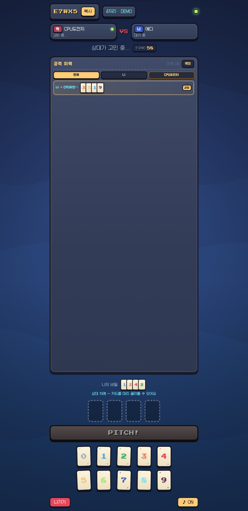

숫자야구의 판정은 간단하다. 숫자와 자리를 세어 스트라이크와 볼을 매기는 것뿐이다. 그래서 브라우저가 판정해도 게임은 돌아간다. 문제는 그 방법이 상대의 비밀 숫자를 내 화면까지 데려온다는 것이다. 화면이 비밀을 알면, 소스를 뒤져 비밀을 읽는 치트가 생긴다.

판정을 서버에 두기로 한 결정은 [앞 기록](/blog/projects/number-baseball/logs/01-one-day-number-baseball/)에서 나왔다. 이번 기록은 그 결정을 구현한 방식이다. 판정과 턴 순서, 시계를 전부 서버로 가져갔다. 화면은 상태를 받아 보여줄 뿐이다. 배포에 쓰는 Cloudflare Workers에서 방 하나를 Durable Object 하나로 만들었다. 한 방의 메시지가 한 객체에 모이고 순서대로 처리된다. 실시간 접속자 수는 별도의 Presence 객체가 세고, 바뀔 때마다 모든 화면에 밀어준다.

서버는 같은 판 상태에서 자리마다 다른 시점을 만들어 보낸다. 내 시점에는 나의 비밀이 들어간다. 상대의 비밀은 판이 끝나기 전까지 어떤 시점에도 들어가지 않고, 상대가 비밀을 정했는지 여부만 전달된다. 상대의 비밀은 판이 끝난 뒤에만 공개된다. 시점이 제대로 잘렸는지는 테스트로 고정해 뒀다. 시점 전체를 문자열로 바꿔 뒤져 상대의 비밀이 없음을 확인한다.

시간이 다 되면 서버가 대신 투구한다. 플레이어가 자물쇠로 고정해 둔 숫자는 살리고, 나머지 자리만 겹치지 않게 채운다. 무작위 선택은 함수 인자로 주입할 수 있게 분리해 뒀다. 상태가 정해지면 결과가 따라오므로 테스트에서 재현할 수 있다. 턴 순서와 비밀 생성도 이 방식을 따른다.

네트워크는 끊긴다. 연결이 끊겼다고 바로 기권 처리하면, 잠깐의 끊김에 판이 끝나버린다. 그래서 15초의 유예를 두고, 그동안 판의 시계를 멈춘다. 유예 안에 돌아오면 판이 그대로 이어지고, 넘기면 기권으로 처리한다. 연결이 살아 있는지는 ping과 pong으로 감시한다.

여기까지는 코드와 테스트로 확인한 것이다. 한 가지 한계를 알고 있다. 방의 판 상태는 객체의 메모리에 있다. 배포처럼 객체가 재시작하는 일이 진행 중에 생기면 판이 초기화될 수 있다. 실전에서 이 일이 얼마나 자주 겪게 될지는 아직 모른다. 주말의 판이 답을 줄 것이다.
